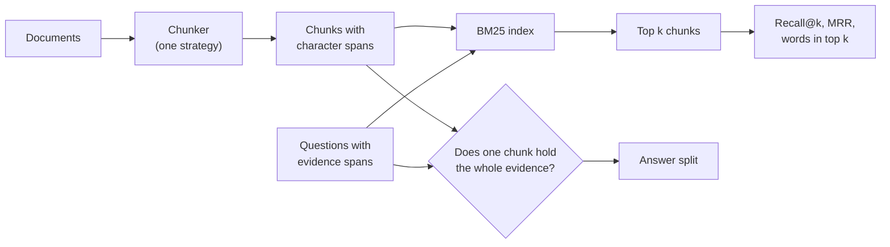

# chunkaudit

[](https://github.com/Vishal-Krishna-Kumar/chunkaudit/actions/workflows/ci.yml)
[](LICENSE)


**Is your chunker cutting the answer in half?**

chunkaudit compares RAG chunking strategies on your documents and tells you two things for each one: how often it splits the text that answers a question across two chunks, and whether retrieval still finds a chunk with the whole answer. It runs offline in seconds. No API key, no model download, one dependency (NumPy).

```
pip install git+https://github.com/Vishal-Krishna-Kumar/chunkaudit.git
chunkaudit demo
```

```
| Strategy | Chunks | Avg words | Answer split | Recall@1 | Recall@3 | Recall@5 | MRR@10 | Words in top 5 |
|---|---:|---:|---:|---:|---:|---:|---:|---:|
| `paragraph:80` | 20 | 60 | 0.0% | 90.0% | 100.0% | 100.0% | 0.950 | 297 |
| `sentence:3:1` | 31 | 56 | 0.0% | 85.0% | 100.0% | 100.0% | 0.925 | 282 |
| `recursive:60` | 27 | 45 | 0.0% | 85.0% | 95.0% | 95.0% | 0.905 | 223 |
| `sentence:2` | 34 | 35 | 0.0% | 80.0% | 100.0% | 100.0% | 0.892 | 181 |
| `fixed:80` | 17 | 71 | 15.0% | 70.0% | 80.0% | 85.0% | 0.760 | 362 |
| `fixed:40:10` | 41 | 38 | 45.0% | 40.0% | 45.0% | 45.0% | 0.433 | 196 |
| `fixed:40` | 32 | 38 | 60.0% | 30.0% | 35.0% | 40.0% | 0.335 | 187 |
```

That is the bundled sample: 5 short articles and 20 questions. Fixed 40-word chunks cut the answer in 12 of 20 questions, and no retriever can recover an answer that no chunk contains.

## What the columns mean

| Column | Meaning |
|---|---|
| Chunks, Avg words | How many chunks the strategy produced and their mean length in words. |
| Answer split | Share of questions whose evidence is not fully inside any single chunk. This depends only on the chunker, not on the retriever. |
| Recall@k | Share of questions where one of the top k retrieved chunks contains the whole evidence. |
| MRR@10 | Mean reciprocal rank of the first chunk that contains the whole evidence, within the top 10. |
| Words in top k | Mean number of words in the top k chunks: what you would send to the language model. |

A strategy is good when the answer split is low, recall is high and the word count is small. Bigger chunks buy recall with words; the table shows what you pay.

## How it works



Every chunk keeps the character span it came from, and every question knows the character span of its evidence. A chunk counts as a hit only if it is from the right document and its span covers the whole evidence span. There is no fuzzy matching and no language model acting as a judge, so the same input always gives the same numbers.

## Use your own data

A dataset is a folder with two JSON Lines files.

`corpus.jsonl`, one document per line:

```json
{"id": "tides", "text": "Tides are the regular rise and fall of sea level along a coast. ..."}
```

`questions.jsonl`, one question per line. `evidence` is the exact text in the document that answers the question:

```json
{"id": "q01", "question": "What mainly causes tides?", "doc_id": "tides", "evidence": "They are caused mainly by the gravitational pull of the Moon, with a smaller contribution from the Sun."}
```

If the same text occurs more than once in a document, add `"evidence_start": <character offset>` to say which occurrence is meant. Then:

```
chunkaudit run path/to/dataset
chunkaudit run path/to/dataset -s fixed:300,fixed:300:60,recursive:300 -k 1,5,10 --sort split
chunkaudit run path/to/dataset --format json > audit.json
```

Twenty to fifty questions with marked evidence are enough to see which strategies split answers on your documents.

## Strategies

Sizes are counted in whitespace-separated words.

| Spec | What it does |
|---|---|
| `fixed:200` | 200 words per chunk, cut wherever the count runs out. |
| `fixed:200:50` | The same, with 50 words shared between neighbouring chunks. |
| `sentence:5` | 5 sentences per chunk. Never cuts inside a sentence. |
| `sentence:5:1` | The same, with 1 sentence shared between neighbouring chunks. |
| `paragraph:200` | Whole paragraphs, packed together up to 200 words. A longer paragraph is kept whole. |
| `recursive:200` | Paragraphs, then sentences, then words, packed up to 200 words. Never exceeds the limit. |

Without `-s`, `chunkaudit run` compares nine of these: `fixed:100`, `fixed:200`, `fixed:200:50`, `fixed:400`, `sentence:3`, `sentence:5:1`, `sentence:10:2`, `paragraph:200` and `recursive:200`.

## Use it as a library

```python
from chunkaudit import compare, load_dataset, parse_strategy, sample_path

dataset = load_dataset(sample_path())
results = compare(dataset, [parse_strategy("fixed:40"), parse_strategy("sentence:2")])
for result in results:
    print(result.strategy, f"split={result.split_rate:.0%}", f"recall@5={result.recall[5]:.0%}")
# fixed:40 split=60% recall@5=40%
# sentence:2 split=0% recall@5=100%
```

### Audit your own chunker

Anything with a `name` and a `split(text)` method that returns `(start, end)` character spans can be audited:

```python
import re

from chunkaudit import evaluate, load_dataset, sample_path


class LineChunker:
    name = "lines"

    def split(self, text):
        return [match.span() for match in re.finditer(r"[^\n]+", text)]


result = evaluate(load_dataset(sample_path()), LineChunker())
print(result.chunks, result.split_rate)
# 20 0.0
```

### Use your own retriever

BM25 is the default because it needs nothing installed. To audit with an embedding model, pass `retriever=` a callable that takes the list of chunk texts and returns an object with `search(query, k)`, which returns the positions of the best `k` chunks, best first.

## Limits

- **Lexical retrieval by default.** BM25 rewards shared words. An embedding retriever can rank strategies differently, which is why the retriever is pluggable.
- **Whole-evidence matching is strict.** A chunk with 90% of the evidence counts as a miss. That is deliberate: it is what makes "answer split" meaningful.
- **Words, not tokens.** Sizes are in words to avoid a tokenizer dependency. For English prose, multiply by about 1.3 for a rough token count.
- **Rule-based sentence splitting.** It handles common abbreviations and initials, not every edge case.
- **Evidence must be marked.** You need questions with the answering text identified. chunkaudit does not generate them.

## Development

```
git clone https://github.com/Vishal-Krishna-Kumar/chunkaudit.git
cd chunkaudit
pip install -e ".[dev]"
pytest
```

See [CONTRIBUTING.md](CONTRIBUTING.md). The sample dataset is built by `scripts/build_sample.py`.

## License

MIT. See [LICENSE](LICENSE).
